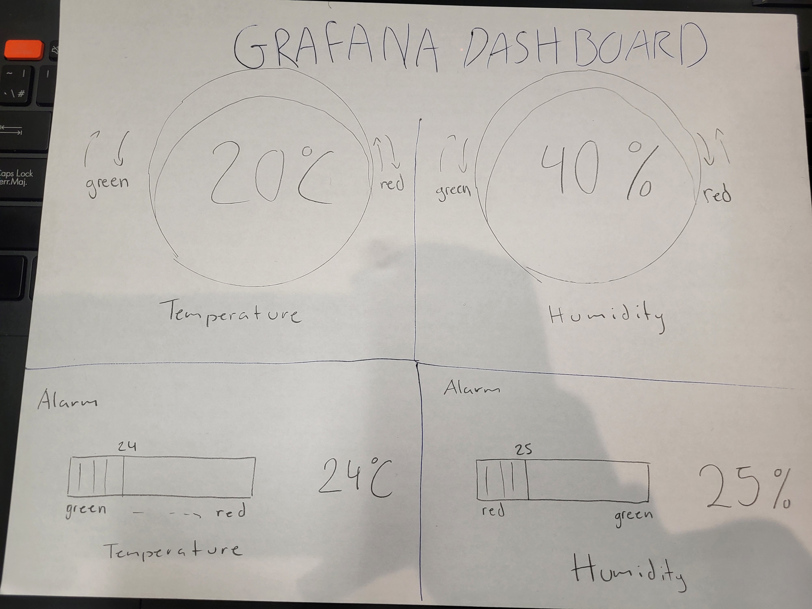
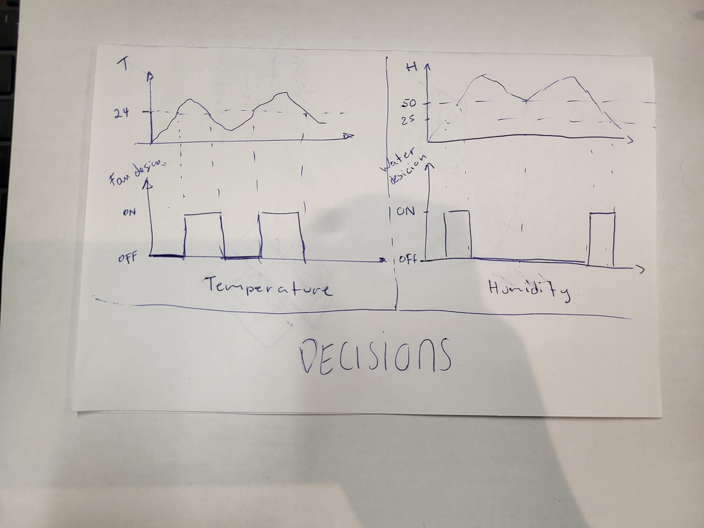

# Smart Greenhouse Project

## 1. Introduction

## 2. Solution Overview

### 2.1 Grafana Dashboard Mockup

## 3. List of Components

### 3.1 Hardware

| Component | Quantity | Purpose |
|---|---:|---|
| Raspberry Pi | 1 | Main controller of the greenhouse |
| MCP3008 ADC | 1 | Converts analog sensor readings into digital values |
| Soil Moisture Sensor | 1 | Measures the moisture level in the soil |
| Temperature Sensor | 1 | Measures the greenhouse temperature |
| 5V Relay Module | 1 | Controls the water pump and ventilation fan |
| Mini Water Pump | 1 | Pumps water from the reservoir to the plant |
| Ventilation Fan | 1 | Provides airflow and helps regulate temperature |
| Water Reservoir | 1 | Stores water for automatic irrigation |
| Water Tubing | 1 | Transports water from the pump to the plant |
| Greenhouse Enclosure | 1 | Provides a protected environment for the plant |
| Plant and Soil | 1 | Represents the growing environment |
| Electronics Enclosure | 1 | Protects the Raspberry Pi, MCP3008 and relay |
| Breadboard | 1 | Used for prototyping electrical connections |
| Jumper Wires | 1 set | Connects sensors and electronic components |
| Power Supply | As required | Provides power to the Raspberry Pi and actuators |

### 3.2 Services

| Component | Purpose |
|---|---|
| Raspberry Pi OS | Operating system for the Raspberry Pi |
| Python | Programming language for the controller |
| GPIO Zero | Controls Raspberry Pi GPIO pins |
| AWS IoT Core | Receives sensor data securely |
| Amazon S3 | Stores raw and processed data |
| AWS Glue | Processes greenhouse data |
| Amazon Athena | Queries historical greenhouse data |
| Amazon EC2 | Hosts the Grafana dashboard |
| Grafana | Displays sensor readings, alarms and system status |
| CloudFormation | Automatically creates AWS resources |
### 3.3 Acounts

- GitHub account
- AWS Academy / AWS account
- Grafana access

## 4. Implementation

### 4.1 Code Snippets

### 4.2 Configuration Notes

## 5. Screenshots of working features

## 6. Troubleshooting and known limitations

## 7. License and Credits

